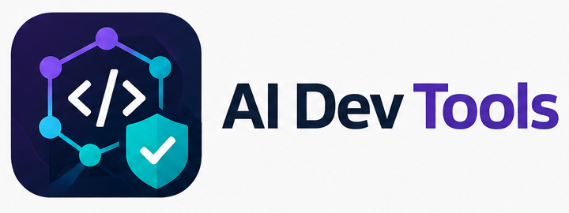
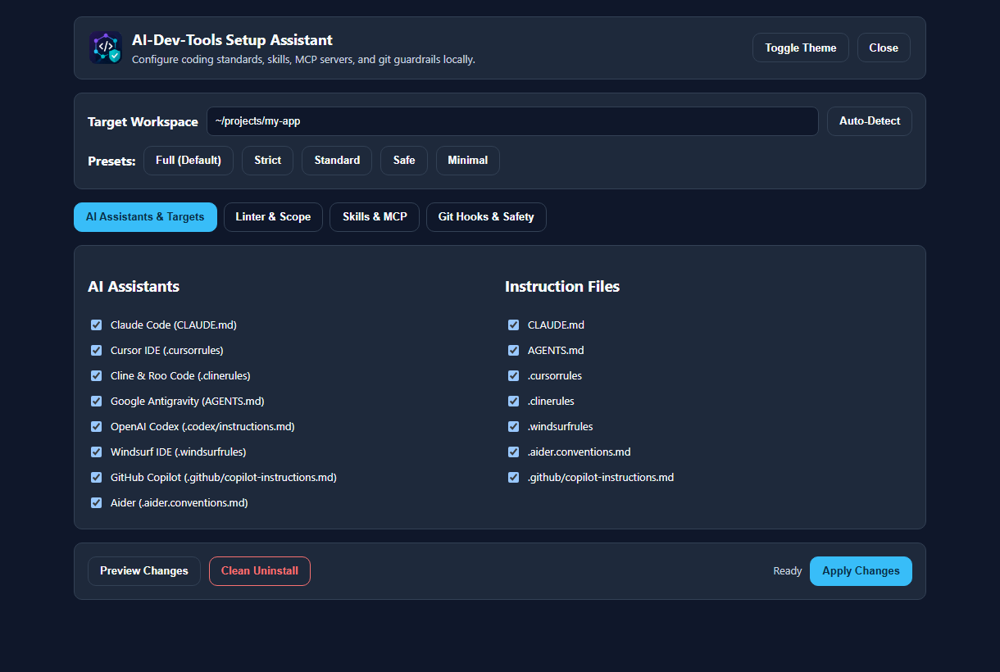

  

# AI-Dev-Tools

**Configure clean coding rules, safety checks, and skills for your AI coding assistants in one click.**

AI-Dev-Tools gives you a simple graphical setup app that equips **Claude Code**, **Cursor**, **Google Antigravity**, **GitHub Copilot**, **Cline**, **Windsurf**, and **Aider** with consistent engineering guardrails. Everything runs locally on your computer with automatic backups and one-click undo.

---

## Download

| Platform | Download | How to Install |
| :--- | :--- | :--- |
| **Windows** | [adt-setup-Windows.exe](https://github.com/DontKwo/ai-dev-tools/releases/latest/download/adt-setup-Windows.exe) | [Windows Install Steps](docs/INSTALLATION.md#windows) |
| **macOS** | [adt-setup-macOS.zip](https://github.com/DontKwo/ai-dev-tools/releases/latest/download/adt-setup-macOS.zip) | [macOS Install Steps](docs/INSTALLATION.md#macos) |
| **Linux** | [adt-setup-Linux.tar.gz](https://github.com/DontKwo/ai-dev-tools/releases/latest/download/adt-setup-Linux.tar.gz) | [Linux Install Steps](docs/INSTALLATION.md#linux) |

Browse release notes on [All Releases](https://github.com/DontKwo/ai-dev-tools/releases/latest).

---

## Screenshots

  

---

## How to Use

1. **Download `AI-Dev-Tools`** from the table above for Windows, macOS, or Linux.
2. **Launch the Setup Assistant** following [Desktop Installation Guide](docs/INSTALLATION.md) if your OS displays an unverified-app prompt.
3. **Choose your workspace folder** and click **Auto-Detect** to select the AI assistants in your project.
4. **Click "Preview Changes"** to inspect exact edits, then click **Apply Changes** (or **Clean Uninstall** to restore backups anytime).

---

## Key Features

- **Multi-Assistant Setup**: Configures `CLAUDE.md`, `AGENTS.md`, `.cursorrules`, `.clinerules`, and Copilot rules together.
- **Built-In Safety Backups**: Saves `.bak` copies before overwriting existing files and supports clean one-click uninstall.
- **112 Automated Checks**: Keeps codebases clean, strongly typed, and uniform across repositories.
- **100% Local**: No accounts, cloud syncing, or subscriptions required.

---

## Documentation

### User Documentation
- [User Guide](docs/USER_GUIDE.md)
- [Everyday Quickstart](docs/user/quickstart.md)
- [Desktop Installation Guide](docs/INSTALLATION.md)
- [Frequently Asked Questions](docs/FAQ.md)

### Developer Documentation
- [Developer Guide](docs/DEVELOPMENT.md)
- [Developer uv Installation](docs/UV_INSTALLATION.md)
- [CLI Reference](docs/power-users/cli-reference.md)
- [YAML Configuration Guide](docs/power-users/yaml-guide.md)
- [Rule Profiles Reference](docs/power-users/profiles.md)

### AI & Technical Documentation
- [AI Agent Rules](AGENTS.md)
- [System Architecture](docs/ARCHITECTURE.md)
- [112 Linter Rules Reference](docs/LINTER_RULES.md)
- [Developer Manual](docs/DEV_MANUAL.md)
- [Agent Skills Guide](docs/SKILLS_GUIDE.md)
- [Rule Files Reference](docs/RULE_FILES.md)
- [UI Quality Rules](docs/UI_RULES.md)

### Legal & Security Policies
- [Security Policy](SECURITY.md)
- [Third-Party Notices](THIRD_PARTY_NOTICES.md)
- [MIT License](LICENSE)

---

## Safety & Disclaimers

- **Official `main` Releases Only**: Download installers exclusively from [DontKwo/ai-dev-tools Releases](https://github.com/DontKwo/ai-dev-tools/releases/latest) (`main` branch). Never run forked builds unless you are sure they contain no malware; only official `main` releases are maintained by the author, and I make no promises.
- **OS Security Warnings**: Windows SmartScreen and macOS Gatekeeper will likely warn that independently built executables are unrecognized or unsafe. Bypassing prompts is strictly at your own discretion following [Desktop Installation Guide](docs/INSTALLATION.md).
- **Workspace Modification & AS-IS Disclaimer**: This tool creates and updates configuration, instruction, skill, and git hook files inside folders you select. Provided "AS IS" under the [MIT License](LICENSE) with zero warranty or liability; review change previews and back up files at your own risk.
