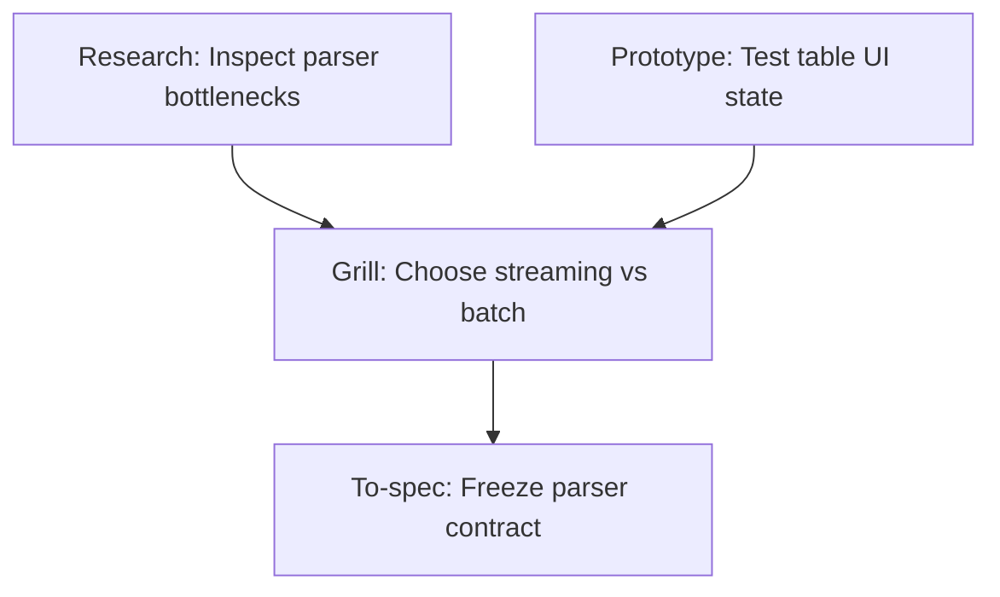

# Wayfinder

Map foggy, multi-session engineering efforts using small uncertainty-shrinking steps before committing to broad implementation plans.

## Core loop

1. **Locate or initialize the map ticket**: Check the issue tracker (or `.scratch/wayfinder-map.md`) for an existing map labeled `wayfinder:map`. Create one if absent.
2. **Audit knowns vs unknowns**: List settled decisions alongside high-leverage unknowns still blocking architectural confidence.
3. **Pick the next uncertainty reducer**: Issue the smallest typed step that collapses maximum uncertainty:
   - **Research**: Gather hard facts from primary code, docs, or benchmarks via [research](../research/SKILL.md).
   - **Prototype**: Build a throwaway HTML/script spike via [prototype](../prototype/SKILL.md) to test interaction or data flow.
   - **Grilling**: Lock product or architecture choices with the user via [grill-user](../grill-user/SKILL.md).
   - **Task**: Slice concrete execution once the path is clear (`/to-spec`, `/to-tickets`).
4. **Maintain the living DAG**: Keep the map concise using a Mermaid `flowchart TD` diagram showing node statuses (`done`, `active`, `blocked`, `open`) and update it after every completed node.

